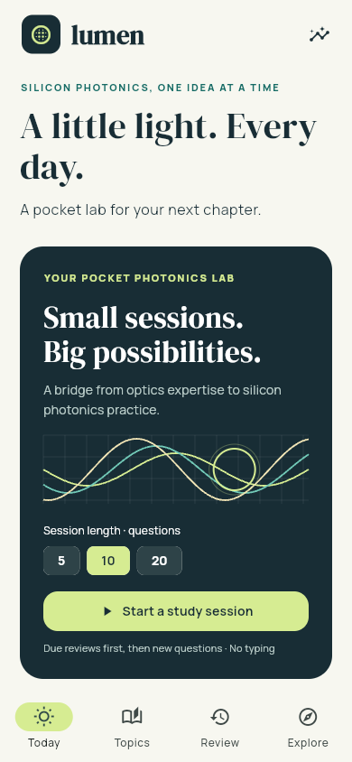

# Lumen · Silicon photonics

A mobile-friendly Flutter study app for an optics PhD moving into silicon photonics, with **320 original questions**, 16 topics, 12 Bay Area employers and 30 learning resources. The research was checked on **October 1, 2026**.



## Try it

**[Open Lumen on your phone](https://larsdu.github.io/PhotonicsQuiz/)**. Add it to your home screen for quick study sessions. Progress stays in that browser on that device; no account is required.

After building locally, the web app is in `build/web`. From this repository, run:

```sh
node tool/serve.mjs 8080
```

Open <http://127.0.0.1:8080>. For Flutter development:

```sh
flutter pub get
flutter run -d chrome
```

Flutter 3.47.6 / Dart 3.13.5 was used here. Install the [Flutter SDK](https://docs.flutter.dev/get-started/install) and add its `bin` directory to your PATH. No server, account or API key is needed for study.

## Studying

- **Today:** choose 5, 10 or 20 questions. Due work comes first, followed by new questions. Close a session and resume it later.
- **Topics:** search 16 modules and filter foundation, applied or advanced material.
- **Review:** due questions, incomplete/incorrect answers, and bookmarks.
- **Explore:** local employers, courses, technical reading, a suggested 12-week transition and a saved portfolio checklist.
- **Progress:** topic retention, checked-answer accuracy, and JSON backup export/restore.

The formats are 58 single-choice questions, 64 tap-to-fill blanks, 112 mental/spoken recall prompts, 32 multiple-selection questions, 32 tap-to-sequence problems, and 22 numerical questions. No quiz answer requires typing. Each question has an explanation and related reading.

Recall answers use **Again / Almost / Got it** self-assessment. They are excluded from automatically checked accuracy. Again schedules 10 minutes; Almost schedules one day; consecutive correct/full recalls schedule 1, 3, 7, 14, 30, then 60 days. “Retained” means three consecutive full recalls or correct answers, not an externally validated mastery certificate.

The curriculum covers platforms, guided modes, passive circuits, MZIs, resonators, coupling, modulation, detectors, lasers, fabrication, simulation, layout, characterization, links/CPO, packaging/reliability, and sensing/quantum/nonlinear applications. The content emphasizes practical semiconductor, RF, design and test gaps alongside existing optics knowledge.

## Research

Open [the employer, course and skills report](docs/research.html), or use Explore in the app. The employer directory includes Santa Clara teams at Xscape, OpenLight, SiPhi, ANELLO, Silitronics, NVIDIA, Marvell/Celestial AI and Intel; nearby targets include Ayar Labs, Broadcom, Lightmatter and PsiQuantum. Every entry links to company evidence and a live role search where available. Office locations are distinct from individual job locations; suggested skill mappings are inferences rather than verified requirements for every company.

Primary learning references include UBC/edX, AIM Photonics, MIT teaching packages, Southampton's syllabus, ePIXfab training, official Ansys Optics examples and GDSFactory documentation. Reading includes research reviews, Journal of Lightwave Technology, Photonics Spectra, Laser Focus World, Lightwave, OFC and SPIE Photonics West. Verify course dates, fees, enrollment and tool/foundry access with providers.

Questions are originally authored practice material. Links supply related reading; the app does not reproduce course question banks or claim provider endorsement. All questions and answers are inspectable in `assets/content/` and the generated `assets/curriculum.json`.

## Build and phone use

```sh
flutter build web --release --no-web-resources-cdn
node tool/cache_web.mjs
node tool/serve.mjs 8080
```

Serve the complete `build/web` directory over **HTTPS** for phone installation and service-worker support. Add to Home Screen from Safari, or install from a supporting Android browser. After the first online cache installation completes, the study app can reopen offline. Course/company links require connectivity. Browser storage can be evicted or cleared, so export progress periodically. Rebuilding the web app requires rerunning `cache_web.mjs` to produce its versioned offline cache.

To preview on another device on the same Wi-Fi, `node tool/serve.mjs 8080 0.0.0.0` serves the app at this computer's LAN address. Plain HTTP LAN previews do not enable offline installation; use HTTPS hosting for that.

### GitHub Pages

The public site is <https://larsdu.github.io/PhotonicsQuiz/>. GitHub Pages publishes the built app from the root of the `gh-pages` branch; the Flutter source is on `main`. The deployment includes the [research report](https://larsdu.github.io/PhotonicsQuiz/research.html).

To publish updates, commit and push the source changes, then run:

```sh
bash tool/publish_pages.sh
```

This requires Flutter, Node, Git and an authenticated GitHub CLI (`gh`). Set `LUMEN_FLUTTER` to the Flutter executable if it is not on your PATH. The script builds with the `/PhotonicsQuiz/` base path, prepares the offline cache, and pushes a new deployment commit without replacing branch history. GitHub may take a few minutes to make it live. An already open app picks up a new build after reopening/reloading online.

To preview the same project path locally:

```sh
flutter build web --release --no-web-resources-cdn --base-href /PhotonicsQuiz/
node tool/cache_web.mjs
node tool/serve.mjs 8081 127.0.0.1 /PhotonicsQuiz/
```

Native projects are included:

```sh
flutter run -d <device-id>
flutter build apk --release
flutter build ios --release
```

Android requires a configured Android SDK and accepted licenses. iOS requires full Xcode and appropriate signing/provisioning. Native builds were **not verified** on this machine because its Android command-line SDK is missing and Xcode is incomplete. The release web build was verified. No app-store publishing has been performed.

## Content and verification

```sh
node tool/build_content.mjs
node tool/research_report.mjs
flutter analyze
flutter test
```

The content generator enforces 20 unique questions per topic and validates options. Tests exercise content integrity, calculation examples, multiple-selection/order grading, spacing, persistence, atomic backup validation, resume behavior, topic filtering and all six phone interactions, including enlarged text at 320px.

Optional developer tools:

```sh
npm install --prefix tool
npx --prefix tool playwright install chromium
node tool/make_icons.mjs
node tool/browser_smoke.mjs http://127.0.0.1:8080
```

The app's icons are rendered from `assets/branding/lumen.svg`. Manrope, DM Serif Display and Noto Sans fonts are bundled with their OFL licenses in `assets/fonts/`, including Greek/scientific-character fallback. `pubspec.lock` pins Flutter package dependencies. Node tooling is used only for development; it is not needed by the installed app.
